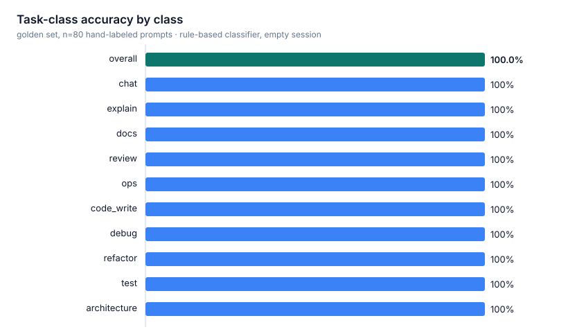
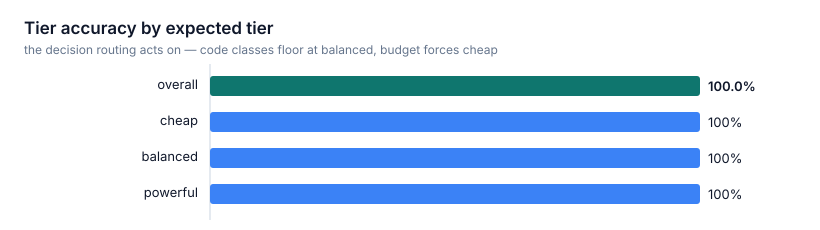
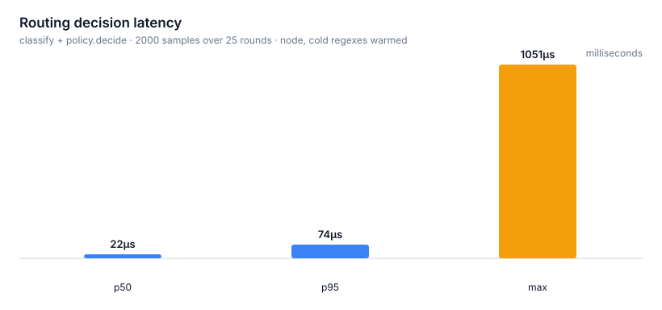
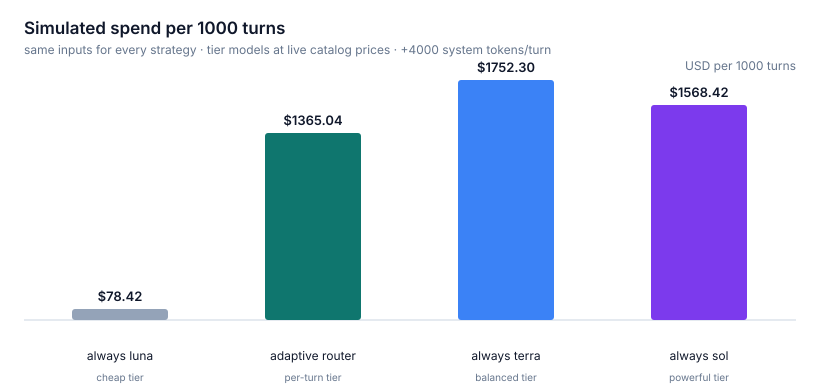

# opencode-adaptive-router

An [OpenCode](https://opencode.ai) plugin that routes every prompt to the model that
deserves it — a cheap model for trivial turns, a mid-tier model for real work, a
powerful model for the hard stuff — and then **verifies the model it picked is the
model that actually ran the turn**.

Most agents run one model for everything. That means either burning a frontier
model on "say OK" (money) or running a cheap model on architecture work (quality).
This plugin classifies each turn *before* the model resolves, switches the session
model per turn (tools and session context intact), watches the event stream to
confirm the switch took effect, and records cost/latency/outcome per decision.

```
prompt ─▶ classify ─▶ select tier ─▶ switch session model ─▶ turn runs on it
              │                          │                        │
              │                          │        ┌───────────────┘
              │                          ▼        ▼
              │                   verify: did the model that executed the turn
              │                   match the selection? (telemetry says so)
              └─ budget guard, manual-override detection, retry escalation
```

- **Deterministic phase-1 classifier**: regex/keyword signals, session context, and
  repo state in; `taskClass + complexityBand` out. No network calls, no added
  latency (p95 ≈ 74µs, see [benchmarks](#benchmarks)).
- **Real routing, not advice**: in `auto` mode the plugin calls the host's model
  switch before the turn starts. The turn — including every tool-call
  continuation — executes on the selected model.
- **A verification loop**: decisions settle as `verified`, `mismatched`, `manual`,
  or `unobserved` by correlating live server events. Routing that only *claims*
  to work is not routing.
- **Client-agnostic core**: the engine (`src/core`, `src/router.ts`) depends on
  nothing but a `RouterHost` interface. OpenCode specifics live in one adapter
  file. A learned classifier or a different host can slot in without touching the
  engine (see [roadmap](#roadmap)).

Built and verified against **OpenCode server 2.0.27** / `@opencode/plugin` 2.0.27.

---

## Table of contents

- [Live end-to-end evidence](#live-end-to-end-evidence)
- [Install](#install)
- [Configuration](#configuration)
- [Commands](#commands)
- [How to test](#how-to-test)
- [Benchmarks](#benchmarks)
- [Behavior guarantees](#behavior-guarantees)
- [Compatibility notes](#compatibility-notes)
- [Limitations](#limitations)
- [Roadmap](#roadmap)
- [Project layout](#project-layout)

## Live end-to-end evidence

Every claim below comes from a live session with three pinned tiers
(`cheap = openai/gpt-6-luna`, `balanced = openai/gpt-5.6-terra`,
`powerful = openai/gpt-6.1-sol`), read back from the plugin's persisted telemetry
(the `kv` table of `~/.local/share/opencode/opencode.db`):

| Prompt (abridged) | Classification | Action | Verified outcome |
| --- | --- | --- | --- |
| `Say OK` | `chat / trivial` | switched to **gpt-6-luna** | `verified` — executed on luna, `finish=stop`, **$0.0029**, 7 output tokens |
| `Refactor the test suite organization of this project. First read src/router.ts and test/router.test.ts, then propose a plan that splits the monolithic test file … Compare the tradeoffs …` | `test / complex` | switched to **gpt-6.1-sol** | `verified` — executed on sol, 5 model calls (tool reads + answer) folded into one decision, **$0.0799**, 16s turn |
| Moderate tool-heavy prompt | `architecture / moderate` | stayed on **gpt-5.6-terra** | verified via session message history — all 10 tool-call continuations executed on terra |

The second row is the important one: the router did not just switch and hope. The
verification loop correlated `session.step.started`/`session.step.ended` events,
confirmed every step of the turn (including tool-call continuations) ran on the
selected model, and folded the accumulated cost into the decision record.

## Install

Requires Node 20+ and OpenCode 2.0.x.

```bash
git clone https://github.com/aneeshkp/opencode-adaptive-router
cd opencode-adaptive-router && npm install
```

Then register it in your `opencode.jsonc` **via the `plugins` array**:

```jsonc
{
  "plugins": [
    {
      "package": "/absolute/path/to/opencode-adaptive-router",
      "options": {
        "tiers": {
          "pinned": {
            "cheap": ["openai/gpt-6-luna"],
            "balanced": ["openai/gpt-5.6-terra"],
            "powerful": ["openai/gpt-6.1-sol"]
          }
        }
      }
    }
  ]
}
```

Without `tiers.pinned`, the router discovers models from the live catalog and
buckets them by blended $/Mtok (cheap ≤ $1.5, balanced ≤ $8, powerful = rest,
subject to the policy filters below). Pinning is recommended: it makes routing
deterministic and the telemetry readable.

> **Pick one install method.** The repo also has a root `index.ts` so
> `.opencode/plugins/` symlink auto-discovery works. If you use *both* the config
> array and a symlink, OpenCode loads the plugin twice under the same id and you
> get two engines fighting over one session. Choose the config array (options
> only flow through it) **or** the symlink, never both.

## Configuration

All options are optional and validated/clamped at load. Full annotated example in
[`config.example.jsonc`](config.example.jsonc). Defaults:

| Option | Default | Meaning |
| --- | --- | --- |
| `mode` | `"auto"` | `"auto"` switches models; `"advisory"` only logs the decision |
| `routePrimaryOnly` | `true` | skip subagent (child) sessions |
| `respectManualSelection` | `true` | a manual `/models` switch disables routing for that session |
| `tiers.cheapMaxBlendedUsd` | `1.5` | max blended $/Mtok for the cheap bucket |
| `tiers.balancedMaxBlendedUsd` | `8` | max blended $/Mtok for the balanced bucket |
| `tiers.pinned` | `{}` | explicit per-tier candidate lists (`"provider/model"`) |
| `bandTierOverride` | `{}` | map a complexity band to a different tier |
| `minBalancedClasses` | `["architecture", "code_write", "debug", "refactor", "test"]` | task classes floored at balanced — cheap models are for discovery and conversation, execution stays mid-tier |
| `policy.maxOutputCostPerMTok` | `60` | hard cap on output $/Mtok for any routed model |
| `policy.allow` / `policy.deny` | `[]` | model allow/deny lists |
| `policy.preferCurrentProvider` | `true` | prefer the session's provider on ties |
| `policy.contextSafetyFactor` | `1.25` | (prompt + session + est. output) × factor must fit the window |
| `policy.outputReserveTokens` | `8192` | headroom for the model's own output |
| `policy.allowStatuses` | `["active", "beta"]` | catalog statuses allowed |
| `policy.registryTtlMs` | `300000` | model-list cache TTL |
| `escalation.enabled` | `true` | on provider failure, escalate one tier and retry |
| `escalation.maxHops` | `1` | max in-turn escalation hops |
| `escalation.retryDelayMs` | `500` | delay before the escalated retry |
| `budget.sessionMaxUsd` | `10` | past this, route everything to the cheapest fit |
| `budget.dailyMaxUsd` | `50` | daily equivalent |
| `telemetry.retain` | `400` | decision records kept (ring) |
| `telemetry.promptPreviewChars` | `120` | prompt text stored per decision (`0` disables) |
| `telemetry.persistDebounceMs` | `2000` | max persist interval |

## Commands

`/router` is a **TUI-only** command (run-mode clients cannot execute commands;
`opencode run "..."` goes through the prompt hook, which is quote-wrapped — the
router strips the quotes before its slash check, so nothing is routed or
recorded for command prompts):

- `/router` or `/router report` — recent decisions with verification status,
  cost, latency, and any seam warnings
- `/router stats` — per-model aggregates: uses, outcomes, verified count, spend
- `/router status` — engine state, tier assignments, budget counters

Slash-command prompts never reach a model, so the router skips them entirely
rather than polluting telemetry.

## How to test

```bash
npm install
npm test        # 94 tests: unit suites (analyzer, policy, registry,
                # telemetry, router engine, adapter wire-format contract)
                # + golden-set benchmark gates
npm run typecheck
```

**End-to-end against a live server** (what the evidence table above was produced
with):

1. Create a sandbox project with pinned tiers and the plugin registered
   (see `config.example.jsonc`).
2. Send a trivial prompt and a complex one:
   ```bash
   opencode run "Say OK"
   opencode run "Refactor the test suite organization of this project. First read
   src/router.ts, then propose a plan that splits the monolithic test file by
   module, and list the exact new files you would create."
   ```
   The run header (`agent · model`) shows the model actually serving the turn.
3. Read back the telemetry:
   ```bash
   sqlite3 ~/.local/share/opencode/opencode.db \
     "SELECT value FROM kv WHERE key LIKE '%router/records'" \
     | jq '.[] | {tier, selected: .selected.id, verification, actualModel, outcome}'
   ```
   Expect `verification: "verified"` with `actualModel` matching `selected`, and
   the outcome carrying `finish`, `costUsd`, and token counts.
4. In the TUI, `/router report` renders the same records as a message.

**Benchmarks** (see below):

```bash
npm run bench    # runs the golden-set gates + writes docs/benchmarks/*.svg
```

## Benchmarks

Golden set: **80 hand-labeled prompts, 8 per task class**, classified against an
empty session. The gates live in `bench/bench.test.ts` (so plain `npm test`
enforces them too): class accuracy ≥ 75%, tier accuracy ≥ 85%, every class ≥ 50%,
p95 decision latency < 2ms, and adaptive cost < always-balanced/powerful.

| Metric | Gate | Measured |
| --- | --- | --- |
| Task-class accuracy | ≥ 75% | **100%** |
| Tier accuracy | ≥ 85% | **100%** |
| Decision latency (p50 / p95 / max) | p95 < 2ms | **22µs / 74µs / 1.05ms** (2000 samples) |





**Cost simulation** — same inputs for every strategy (prompt estimate + 4k
system/tool tokens measured on a live turn), output estimate from the classifier,
prices from the live catalog for the pinned models (luna $0.10/$0.50, terra
$2/$12, sol $2/$10 per Mtok):

| Strategy | Simulated spend / 1000 turns |
| --- | --- |
| always cheap (luna) | $78 |
| **adaptive router** | **$1,365** |
| always powerful (sol) | $1,568 |
| always balanced (terra) | $1,752 |



The router never beats always-cheap on raw cost — that is not the point. It costs
**22% less than always-balanced and 13% less than always-powerful** while still
reserving the powerful tier for genuinely hard turns. Quality-per-dollar is the
objective; the budget guard is the hard ceiling.

**Methodology, honestly:** the 100% figures are *post-calibration*. The first
benchmark run measured 75% class / 90% tier accuracy and exposed five real
classifier gaps — plural failure nouns (`"errors"` never matched `\berror\b`),
missing docs vocabulary (`guide`, `runbook`), single-keyword ops commands and
single-verb build requests falling through to `chat`, and tie-breaks that let
`debug` steal review intents. Each gap is now pinned by a regression test
(`test/analyzer.test.ts → "calibration regressions"`). Labels and lexicon were
therefore co-designed; treat the gates, not the 100%, as the contract, and expect
real-world prompts to land somewhere between the two.

## Behavior guarantees

- **The turn runs on the selected model.** Switching happens in the prompt hook,
  before OpenCode resolves the model; tool calls and session context are
  preserved (verified live, see evidence table).
- **The router refuses to fight you.** A manual `/models` switch marks the
  session manual and stops routing it (`respectManualSelection`).
- **Subagents are left alone** (`routePrimaryOnly`) — the parent agent already
  decides their models.
- **Slash commands are skipped** — they never reach a model, so routing them
  would only pollute telemetry.
- **Failures escalate, once.** A provider failure may hop one tier up and retry
  (`escalation.maxHops`); a decision that never observes a completion settles as
  `unobserved` with a seam warning instead of pretending.
- **Budgets are hard.** Past `sessionMaxUsd` / `dailyMaxUsd` the router degrades
  to the cheapest model that still fits the context window.
- **Every decision is auditable.** Classification evidence, considered
  alternatives, verification state, and outcome (cost, tokens, finish reason,
  latency) are persisted for the last 400 turns and renderable via `/router`.

## Compatibility notes

Verified against OpenCode server **2.0.27**. The plugin guide's documented event
names (`message.completed`, `session.idle`) **do not exist on the wire** — a turn
instead emits `session.step.started` / `session.step.ended` per model call (the
ended event carries no model, so the adapter correlates the pair by message id),
plus `session.execution.succeeded|failed` and `session.model.selected` for
lifecycle and switch detection. `src/adapters/opencode.ts` normalizes all of
this, accepts older `properties`-style envelopes defensively, and logs unknown
event shapes once each so drift is visible; `test/adapter.test.ts` pins the wire
format with payloads captured from the live stream.

## Limitations

- Phase 1 classification is **deterministic rules**, not ML. It is fast,
  auditable, and debuggable — and it will misclassify creative phrasings the
  lexicon does not know. The `advisory` mode exists to evaluate on your own
  traffic before trusting `auto`.
- Complexity scoring is a heuristic over structural features (length, file
  paths, code fences, multi-step markers, class priors). Session-context signals
  (grown context, recent errors) are included but not exercised by the golden
  set, which classifies each prompt cold.
- The cost simulation models spend from token estimates and catalog prices; it
  does not measure real spend. Real spend lands in telemetry only for routed
  turns that complete observably.
- `session.execution.aborted` is mapped defensively but was never observed on
  the wire; an aborted turn's decision settles as `unobserved` on the next
  prompt.
- Telemetry persists in the host's SQLite `kv` store and is scoped to the
  machine, not the project.

## Roadmap

- **Phase 2 — swap the classifier**: integrate the Jev classifier
  (jevtypesafeai.com/jev/classifier) behind the existing `Classification`
  interface; the engine, policy, verification loop, and telemetry stay untouched.
- **Phase 3 — learned routing**: per-model success/latency/cost stats are already
  collected in telemetry; replace the band→tier mapping with success-per-dollar
  scoring over those stats, keeping the `SelectionPolicy` interface identical.
- Prompt-rewrite optimization (e.g. compressing over-long prompts for cheap
  models) is deliberately out of scope for phase 1.

## Project layout

```
src/
  index.ts            plugin entry: hooks, command, disposal
  router.ts           RouterEngine: admission, verification, retry escalation
  config.ts           option parsing + validation (defaults live here)
  adapters/opencode.ts  RouterHost over the V2 plugin context + wire normalizer
  core/
    types.ts          domain model (Tier, TaskClass, Classification, …)
    host.ts           RouterHost seam — the engine's only view of the world
    analyzer.ts       feature extraction + rule-based classifier
    registry.ts       model catalog, tier bucketing, context fit
    policy.ts         classification → tier decision (auditable)
    telemetry.ts      decision ring, verification, stats, budgets, reports
test/                 unit tests incl. wire-format + calibration regressions
bench/                golden-set dataset, SVG renderer, benchmark harness
docs/benchmarks/      generated charts + results.json (committed)
```

## License

[Apache-2.0](LICENSE)
